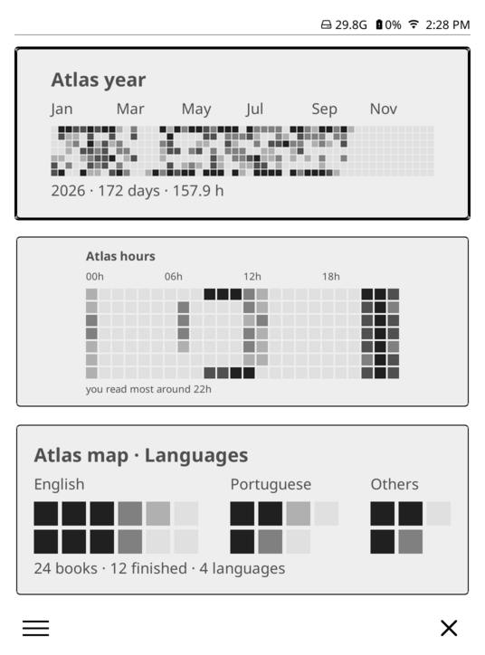
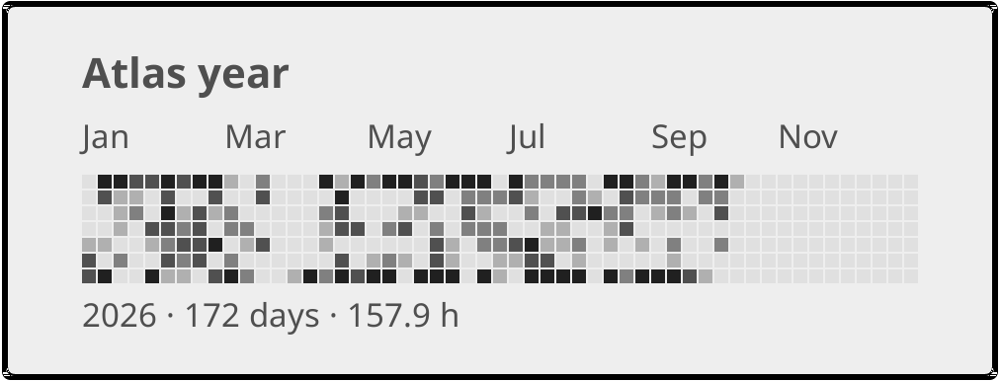
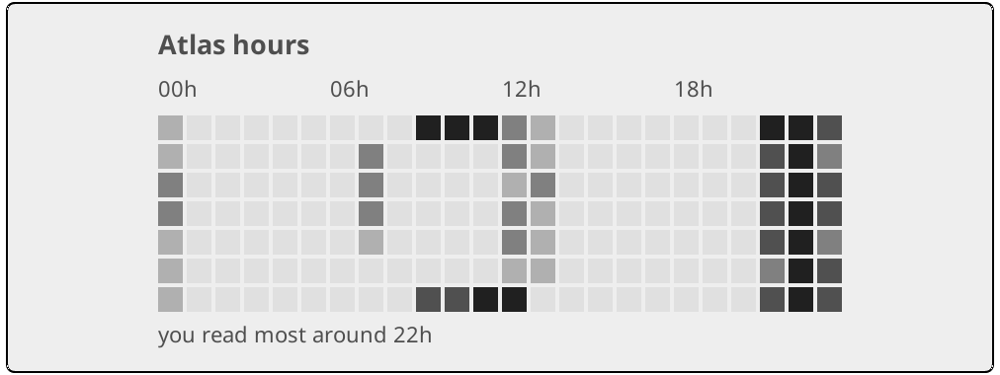
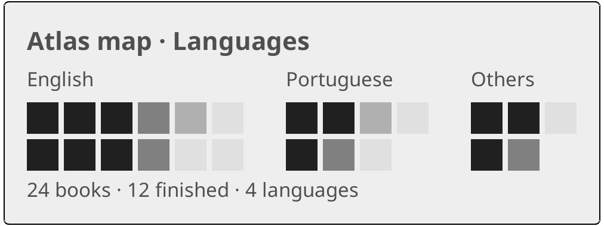
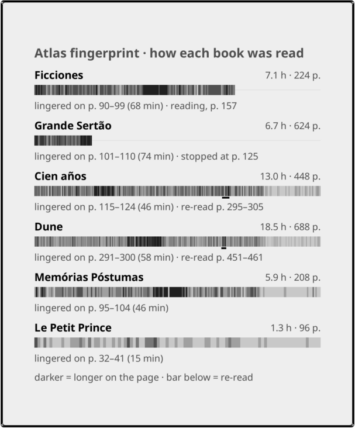

# Reading Atlas

Reading insights for [KOReader](https://koreader.rocks), as drop-in
micro-modules for [`bookshelf.koplugin`](https://github.com/AndyHazz/bookshelf.koplugin).

Bookshelf already gives you a home screen worth looking at. Reading Atlas adds
cards to it that show *your reading*: when you read, how much, and what your
library is made of. Everything is computed on the device, from KOReader's own
data. Nothing needs a network and nothing leaves the e-reader.

<p align="center">
  
</p>

<p align="center"><sub>The three cards in bookshelf's full-screen module view,
on a Paperwhite-sized screen. Rendered in KOReader desktop with a sample library
and simulated statistics.</sub></p>

---

## The modules

| Card | Key | Reads | On a real device |
|------|-----|-------|------------------|
| Atlas year | `atlas_heatmap` | `statistics.sqlite3` | verified on a Kindle |
| Atlas hours | `atlas_clock` | `statistics.sqlite3` | verified on a Kindle |
| Atlas map | `atlas_map` | bookshelf's library | not yet verified |

### Atlas year



A year of reading as a grid of days, with month labels and your totals for the
year underneath.

Intensity is **time read**, bucketed into five steps by **quartile of your own
history**. A twenty-minute-a-day reader and a three-hour-a-day reader each see
the shape of their own year, instead of an empty grid or a saturated one.

### Atlas hours



An hour × weekday grid that answers "when do I actually read?", with the hour
you read most called out underneath. In the example above: every evening around
22h, plus weekend mornings.

### Atlas map



Your whole library as territory. Each book is one square, grouped by
**language, author, series or genre**, and shaded by how far you got:
finished (darkest), reading, on hold, unread (lightest).

- Pick the grouping in the card's *Module settings*. Add the card twice to see
  two groupings at once.
- Groups too small to name at card size fold into "Others".
- It reads bookshelf's own library, not the statistics database, so it is full
  even if you have barely opened a book in KOReader.

---

## Install

**You need** KOReader with [bookshelf](https://github.com/AndyHazz/bookshelf.koplugin)
installed and running. For Atlas year and Atlas hours, KOReader's built-in
*Reading statistics* plugin must be on (it is by default); the cards fill in as
you read.

1. Copy the modules into KOReader's **settings** directory (not the plugins
   directory):

   ```sh
   sh tools/install.sh <koreader-settings-dir>
   ```

   | Device | Settings directory |
   |--------|--------------------|
   | Kindle | `/mnt/us/koreader/settings` |
   | Kobo | `/mnt/onboard/.adds/koreader/settings` |
   | Android | `<koreader-dir>/settings` |

   Without a shell, copy by hand: `micromodules/atlas_*.lua` and the
   `micromodules/atlas/` folder go into `<settings>/bookshelf/micromodules/`.

2. Restart KOReader.
3. Open the module grid, long-press a module, tap **+**, and add **Atlas year**,
   **Atlas hours** or **Atlas map**.

`<settings>/bookshelf/micromodules/` lives outside the plugin, so the modules
survive bookshelf updates.

---

## Planned

### Phase 3: the book's fingerprint



One strip per recent book, one line per stretch of it, shaded by how long you
spent there per page. It shows where you got stuck, where you raced, where you
went back to re-read and where you stopped.

It is drawn from the per-page timings in `statistics.sqlite3`. Only the device
keeps those, and no reading app or stats dashboard shows them.

The image is a mockup with simulated data. Design:
[`docs/superpowers/specs/2026-10-15-reading-atlas-phase-3-design.md`](docs/superpowers/specs/2026-10-15-reading-atlas-phase-3-design.md).

<br clear="right">

### Phase 4: the year's shelf

The books finished this year as spines on a shelf: height for pages, thickness
for the hours they took. The ones still open stand apart, filled to where you
got.

### Later, maybe: the reading map, enriched

Country for every book, and genre for the books that carry none. That data
would have to come from elsewhere (bookshelf's Hardcover id would make the
match reliable) and would be drawn as a tile grid rather than country outlines.
Seeing the map running made the case for the *how* of reading over more of the
*what*, so this one waits.

Each phase gets its own design document under [`docs/`](docs/) before any code
is written.

### Not planned

Writing to the statistics database. Anything that needs a network. Replacing
bookshelf, which this project is built to live inside.

---

## Why micro-modules instead of a plugin

Bookshelf documents a drop-in module API: a `.lua` file placed in
`<koreader settings>/bookshelf/micromodules/` is discovered automatically, with
no registry to edit and no fork required.

That buys the whole surrounding UI for free: shelves, covers, search, the home
grid and the full-screen module dashboard. This project only writes the part
that does not exist yet.

The trade-off is coupling. These modules `require` bookshelf's module kit, so a
change to its contract is felt here. That is a deliberate choice in favour of
iteration speed.

---

## Development

### Tests

```sh
sh tests/run.sh          # 10 suites, 126 tests
LUA=luajit sh tests/run.sh
```

The suites run under a standalone Lua interpreter, **not** inside KOReader, by
stubbing the KOReader modules a unit reaches for. Write **Lua 5.1**-compatible
code. KOReader runs LuaJIT, so Lua 5.3's `//` and bitwise operators load fine
on a laptop and then fail on the device. LuaJIT does accept `goto`, but a
Lua 5.1 interpreter running the suites does not, so leave it out too.

All the logic worth asserting is pure and tested here: bucketing, the quartile
scale, the calendar mapping, grid geometry, territory layout and the
three-state cache. SQLite access, blitbuffer painting and bookshelf's real
repository are not, which is what the next two steps are for.

### Preview on a computer

KOReader's Linux and macOS builds run the same Lua as the e-reader, so the
cards can be checked without a device. This is how the screenshots above were
made.

```sh
# A throwaway KOReader home, so your real settings are untouched.
export KO_HOME=$PWD/.kohome
mkdir -p "$KO_HOME/plugins" "$KO_HOME/settings"
cp -r /path/to/bookshelf.koplugin "$KO_HOME/plugins/"
sh tools/install.sh "$KO_HOME/settings"

# Optional: your real reading data, copied from the device.
cp /path/to/statistics.sqlite3 "$KO_HOME/settings/"

# A Kindle Paperwhite's screen.
EMULATE_READER_W=1072 EMULATE_READER_H=1448 EMULATE_READER_DPI=300 \
  /path/to/koreader/bin/koreader
```

Get KOReader from its [releases](https://github.com/koreader/koreader/releases)
(the `linux-x86_64` tarball, the AppImage, or the macOS app), and bookshelf
from [its releases](https://github.com/AndyHazz/bookshelf.koplugin/releases).
In KOReader, set *Start with > Bookshelf*, then add the cards as in
[Install](#install). For a basic Kindle use `600`, `800` and `167`, and turn
off *Settings > Screen > Color rendering* to see the greys as e-ink shows them.

### On the device

The desktop does not stand in for e-ink refresh and ghosting, a slow CPU on a
large library, or the device's memory. Before a module is called done, it runs
on a real e-reader. [`docs/CARRY-FORWARD.md`](docs/CARRY-FORWARD.md) holds the
per-module checklists and what the device taught that no test could, including
the one that crashed a Kindle.

## License

AGPL-3.0, matching bookshelf, whose module kit these modules build against.
