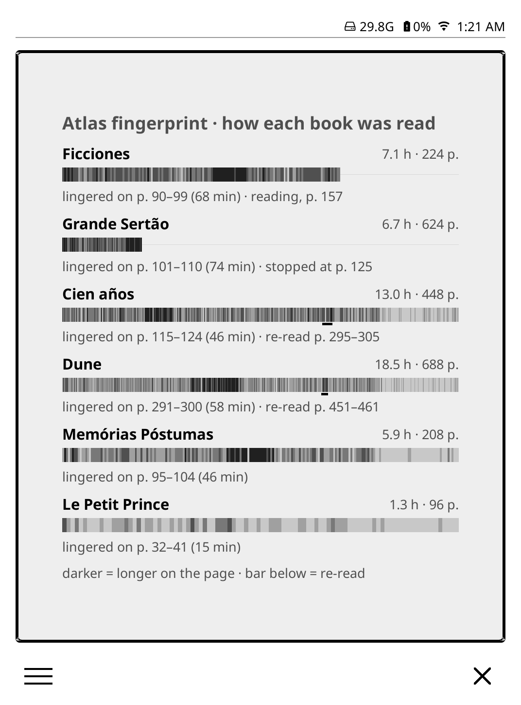

# Reading Atlas — fase 3: a impressão digital do livro

**Data:** 2026-10-15
**Status:** implementado; falta verificar no aparelho (`CARRY-FORWARD.md`)
**Spec anterior:** [`2026-09-23-reading-atlas-phase-2-design.md`](2026-09-23-reading-atlas-phase-2-design.md)
**Plano:** [`../plans/2026-10-19-reading-atlas-phase-3.md`](../plans/2026-10-19-reading-atlas-phase-3.md)

> **O que mudou na implementação** (detalhes no plano):
> - Trechos relidos separados por até 1% do livro viram uma releitura só
>   (`REREAD_BRIDGE`). Sem isso, uma releitura que pula uma página, ou que cai
>   num layout novo, saía como uma barra tracejada.
> - A legenda é "darker = longer per page · bar below = re-read".
> - A premissa sobre TEXT estava errada: o `lua-ljsqlite3` do KOReader v2026.07
>   copia TEXT com `ffi.string`. A leitura antes do `close()` continua, como
>   defesa; ver `CARRY-FORWARD.md`.
> - O teste novo em `_test_source.lua` não foi escrito: a separação de caches
>   por chave já é testada ali de forma genérica. Em troca, `_test_db.lua`
>   testa a consulta contra um SQLite falso.

## Objetivo

Um módulo novo, `atlas_fingerprint`, que mostra **como** cada livro recente
foi lido: uma faixa por livro, uma linha vertical por trecho do livro, e o tom
de cada linha é **quanto tempo você passou ali por página**.

A pergunta que o card responde é "onde eu travei, onde eu devorei, onde eu
voltei para reler e onde eu parei?".



*Mockup renderizado no KOReader v2026.07 desktop (1072×1448, 300 dpi) com
dados simulados. É o protótipo que motivou esta spec, não a implementação.*

## Por que esta, e não o mapa de países

O README previa como fase 3 o mapa geográfico (país e gênero vindos de fora).
Ele muda de lugar, por três motivos:

1. **O mapa territorial da fase 2, visto rodando, não convenceu.** Idioma,
   autor, série e gênero são dados que qualquer app de leitura já tem, e o
   card lê como uma tabela, não como um mapa. Um mapa de países seria mais do
   mesmo eixo — *o quê* — e ainda exigiria rede.
2. **O dado que só o aparelho tem é o tempo por página.** `page_stat_data`
   registra cada página aberta, quando e por quanto tempo. StoryGraph, Apple
   Books e os dashboards de KOReader (KoInsight, KoShelf) mostram totais,
   heatmaps e gêneros; nenhum mostra a forma da leitura *dentro* de um livro.
3. **Cabe na infraestrutura que existe.** Mesmo banco, somente leitura, sem
   rede, o mesmo `source.lua` de três estados, e a escala por quartis de
   `scale.lua`.

O mapa de países vai para depois da fase 4 (a estante do ano) e pode sair do
plano. O `atlas_map` fica como está; a chave é congelada e ele continua
instalável.

## O módulo

| Campo | Valor |
|---|---|
| `key` | `atlas_fingerprint` (congelada a partir do primeiro install) |
| `title` | "Atlas fingerprint" |
| `summary` | "How you read each recent book, page by page. Works offline." |
| `show_settings` | nenhum na v1 |

## Layout

```
Atlas fingerprint
Ficciones                                     7.1 h · 70%
▌▌▌█▌▌▌▌▌▍▍▌▌▌██▌▌▌▌▌▌▌▌▌▌▌▌▌. . . . . . . . . . .
lingered on p. 90–99 (68 min) · reading
Cien años de soledad                         13.0 h · 448 p.
▌▌▌▌▌▌██▌▌▌▌▌▌▌▌▌▌▌▌▌▌▌▌▌▌▌▌▌▌▌▍▍▍▍▍▍▍▍▍▍▍▍▍▍▍▍▍▍
                          ▔▔▔
lingered on p. 115–124 (46 min) · re-read p. 295–305
…
darker = longer on the page · bar below = re-read
```

Por livro, de cima para baixo:

1. **Título** à esquerda (negrito, cortado com reticências), e à direita
   `<horas> h · <páginas> p.` para livro terminado ou `<horas> h · <n>%` para
   livro em andamento.
2. **A faixa**, na largura toda do card. A coordenada horizontal é a
   **posição no livro** (0 a 100%), não o número da página — ver
   *Reflow* abaixo.
   - Trecho lido: linha vertical da altura da faixa, no tom do degrau.
   - Trecho não lido: uma linha pontilhada de 1 px no meio da faixa, em
     `0xD8`, para a faixa mostrar o comprimento do livro sem parecer lida.
3. **Barra de releitura** logo abaixo da faixa, preta, cobrindo os trechos
   relidos. Precisa ter no mínimo `sc(3)` de largura — no mockup, com 1–2 px,
   ela quase sumia.
4. **Nota**, uma linha em cinza:
   - `lingered on p. A–B (N min)`: a janela mais lenta, sempre;
   - `· re-read p. A–B`: o maior trecho relido, se houver;
   - `· reading`: se o último acesso foi há menos de 30 dias e o livro não
     chegou ao fim;
   - `· paused since <mês>`: se não chegou ao fim e o último acesso foi há
     30 dias ou mais.

Uma linha de legenda fecha o card.

### Quais livros

Os livros com mais de **10 minutos** de leitura, do **último acesso mais
recente** para o mais antigo (`book.last_open`). Quantos cabem sai da altura
do card: cada livro ocupa a mesma altura fixa (título + faixa + barra + nota),
e entram tantos quantos couberem, entre **1 e 6**. Sem loop de fonte: o host
continua dono do tamanho (`CARRY-FORWARD.md`).

### Degraus

Por trecho, a medida é **segundos por página**: o tempo total do trecho
dividido pelo número de páginas que ele cobre. Sem essa divisão, um pixel de
um livro de 700 páginas somaria o dobro do tempo de um pixel de um livro de
350, e livros longos pareceriam sempre mais escuros.

Os degraus 1 a 4 são os quartis de `scale.lua`, calculados sobre **todos os
trechos lidos de todos os livros do card juntos**, para que os livros se
comparem entre si: um livro difícil sai mais escuro que um fácil, não só
diferente por dentro. O degrau 0 é *lido, mas de passagem*: menos de 5 s por
página, o folhear.

| Degrau | Tom | Significado |
|---|---|---|
| 4 | `0x20` | quartil mais lento |
| 3 | `0x50` | |
| 2 | `0x80` | |
| 1 | `0xB0` | quartil mais rápido |
| 0 | `0xE0` | folheado (< 5 s/página) |
| não lido | linha pontilhada `0xD8` | |

São os cinco tons do `gridwidget`, já validados no Paperwhite.

## Reflow: posição, não página

`page_stat_data.page` é a página **no layout daquele momento**. Mudar a fonte
ou a margem de um EPUB muda `total_pages`, e a página 120 de antes não é a
página 120 de agora. O próprio KOReader resolve isso na view `page_stat`,
reescalando para a contagem atual — mas essa view multiplica linhas com um
`JOIN` em `numbers` e é cara demais para o aparelho.

O módulo faz a mesma coisa em Lua, mais barato: cada linha vira um
intervalo de posição `[(page − 1) / total_pages, page / total_pages)`, e o
tempo dela é distribuído pelos trechos da faixa que esse intervalo cobre,
proporcionalmente. Os números de página da nota são convertidos de volta
para a contagem **atual** (`book.pages`), para baterem com o que o leitor vê
no livro hoje.

## Releitura

Um trecho foi **relido** quando ele tem leitura em pelo menos dois dias
diferentes **e**, no dia mais recente, o leitor já tinha chegado, em algum
dia anterior, a uma posição pelo menos 5% mais adiante. Ou seja: o leitor
estava mais à frente e voltou.

Isso descarta o caso comum que não é releitura: a página em que uma sessão
termina e a seguinte começa aparece em dois dias, mas ninguém tinha passado
dela.

Trechos relidos vizinhos se juntam numa barra só. Na nota aparece só o maior.

## Janela mais lenta

A janela de `max(10 páginas, 2% do livro)` com mais tempo total, procurada
só sobre o trecho lido. Empate fica com a primeira. Um livro lido abaixo do
tamanho da janela usa o trecho lido inteiro.

## Estados

Os três de sempre, mais um:

| Estado | Quando | Card |
|---|---|---|
| ainda não consultado | consulta agendada | `valueCard` "Reading…" |
| sem estatísticas | banco ausente, ilegível ou vazio | `valueCard` "No statistics" |
| poucos dados | nenhum livro com mais de 10 min | `valueCard` "Not enough reading yet" / "Read a little more and your books will show up here." |

O preview do picker (`ctx.preview`) usa o cache se houver, ou "Reading…",
como a fase 2. Nunca dados falsos.

## Toque

Nenhum na v1. Na sequência natural, tocar abre a impressão digital de um livro
só em tela cheia, com a faixa dobrada em linhas (como um calendário de
páginas) e os capítulos marcados — fica para depois.

## Arquitetura

```
statistics.sqlite3 ─► atlas/db.lua ─► atlas/source.lua ─► atlas/fingerprint.lua ─► atlas/stripwidget.lua
                      (I/O, pcall)    (cache "fingerprint")  (lógica pura)          (paint)
```

### `atlas/db.lua` (alterado)

Ganha `M.fingerprintRows(limit)`. Duas consultas, na mesma conexão
somente leitura:

```sql
-- os livros: os mais recentes com leitura suficiente
SELECT id, title, pages, last_open, total_read_time
FROM book
WHERE total_read_time >= 600
ORDER BY last_open DESC
LIMIT :limit;

-- as linhas desses livros, agregadas por página, layout e dia
SELECT id_book, page, total_pages, start_time / 86400 AS day,
       SUM(duration) AS secs
FROM page_stat_data
WHERE id_book IN (…)
GROUP BY id_book, page, total_pages, day;
```

A agregação por dia mantém o resultado em milhares de linhas mesmo em livros
longos, e é tudo que a regra de releitura precisa.

**`title` é TEXT.** É a primeira consulta do projeto que lê TEXT do
`statistics.sqlite3` — exatamente o caso de `CARRY-FORWARD.md`. O título é
copiado para uma string Lua (`tostring`) **antes** de `conn:close()`. Um teste
não consegue pegar isso; está no checklist do aparelho.

`limit` é 6, o máximo de livros do card.

### `atlas/source.lua` (inalterado)

Uma chave nova, `"fingerprint"`, com os mesmos três estados e a mesma guarda
contra consultas concorrentes. A consulta nunca roda no paint (issue #194 do
bookshelf).

### `atlas/fingerprint.lua` (novo; lógica pura, onde mora o teste)

- `fingerprint.buckets(rows, n_buckets)` → por trecho: segundos, páginas
  cobertas (para o segundos-por-página), e se foi lido. Distribui cada linha
  pelo intervalo de posição dela.
- `fingerprint.rereads(rows, n_buckets)` → lista de intervalos `{ from, to }`
  em índice de trecho, já juntados.
- `fingerprint.slowest(rows, pages)` → `{ from_page, to_page, secs }` na
  contagem atual de páginas.
- `fingerprint.status(book, rows, now)` → `"finished" | "reading" | "paused"`
  com o mês da pausa. Terminado é ter chegado a 97% do livro.
- `fingerprint.levels(all_buckets)` → os limiares compartilhados entre livros,
  via `scale.lua`, e o degrau de cada trecho.

Nenhum `require` do KOReader; testável no `tests/run.sh`.

### `atlas/stripwidget.lua` (novo)

Pinta uma faixa: trechos com tom, a linha pontilhada do não lido e a barra de
releitura. `Widget:extend{}` e construído com `:new{}`, como manda
`CARRY-FORWARD.md`, e o teste de `_test_gridwidget.lua` que confere a herança
ganha um irmão.

O `gridwidget` não serve: ele pinta células quadradas com vão; a faixa é
contínua, um pixel por coluna.

### `micromodules/atlas_fingerprint.lua` (novo)

Só composição: estado → `valueCard`, ou cabeçalho + (título, faixa, nota) por
livro + legenda. Fonte via `Kit.face`, espaço via `Kit.sc`.

## Testes

### No computador (`tests/run.sh`, Lua 5.1)

- `_test_fingerprint.lua` (novo):
  - distribuição proporcional de uma linha por vários trechos e de vários
    trechos de linha num só;
  - **reflow**: o mesmo livro lido com `total_pages` 200 e depois 300 cai nas
    mesmas posições;
  - segundos-por-página: dois livros com o mesmo ritmo e tamanhos diferentes
    dão o mesmo degrau;
  - releitura: voltar de 5% adiante conta; a página de troca de sessão não
    conta; trechos vizinhos se juntam;
  - janela mais lenta, incluindo livro mais curto que a janela;
  - status: terminado a 97%, lendo, pausado com o mês certo;
  - degrau 0 para o folhear.
- `_test_stripwidget.lua` (novo): tamanho, e que herda de `Widget`.
- `_test_source.lua`: a chave `"fingerprint"` não compartilha cache.

### Só no aparelho

A registrar em `CARRY-FORWARD.md`:

1. O card aparece no picker e **tocar nele não derruba o KOReader**.
2. Os títulos aparecem certos — a leitura de TEXT antes de fechar a conexão
   funciona — e acentos sobrevivem.
3. A consulta num banco real, com anos de leitura, não congela o menu.
4. As faixas de livros reais mostram estrutura, não ruído uniforme: se tudo
   sair num tom só, os quartis por card estão errados para dados de verdade.
5. A barra de releitura é visível.
6. Um livro lido com duas fontes diferentes não mostra degraus quebrados.

## Fora de escopo

- Tela cheia de um livro só (o toque).
- Capítulos marcados na faixa: exigiria abrir o documento.
- Destaques (highlights) na faixa: moram no sidecar, não no banco.
- A estante do ano — fase 4, com spec própria.
- Cor.
